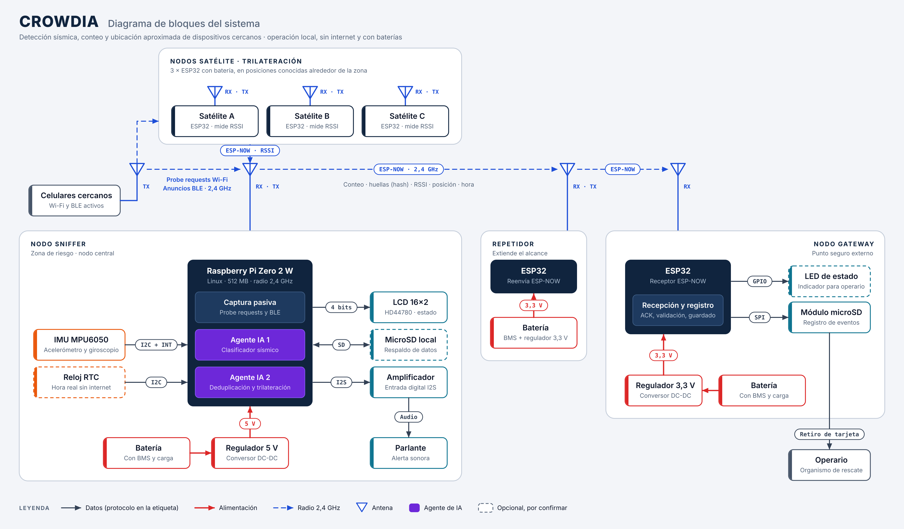

# CROWDIA

**Sistema para apoyar la búsqueda de personas atrapadas después de un terremoto.**

Un nodo instalado en una zona de riesgo cuenta los celulares cercanos escuchando sus señales Wi-Fi y,
con un acelerómetro y un agente de IA, detecta si ocurre un sismo. Al confirmarlo, envía lo captado a
un nodo en un lugar seguro, para que los rescatistas sepan cuántas personas podría haber y dónde
buscar. Todo funciona **sin internet** y **con baterías**.

Proyecto del curso *Diseño de Sistemas Electrónicos* · Universidad Nacional de Colombia, sede Bogotá · 2026-II.



## Estado actual (26 de noviembre de 2026)

| Parte | Estado |
|---|---|
| Sniffer Wi-Fi en ESP32 → Raspberry Pi por UDP | ✅ Funcionando |
| Sismómetro con MPU6050 (detección por reglas, sin falsas alarmas con golpes aislados) | ✅ Funcionando |
| Conteo de dispositivos con agrupación de MAC aleatorias | ✅ Funcionando (error de +0 a +2 equipos) |
| Buzzer (alarma de sismo y aviso de celular nuevo) | ✅ Funcionando |
| Pantalla LCD 16×2 (estado del sismo y conteo de celulares) | ✅ Funcionando |
| Registro de datos en CSV (MAC hasheadas) | ✅ Funcionando |
| Agente IA 1 (modelo sismo / no sismo) | 🔨 Recolectando datos: 15 sacudidas y 20 golpes grabados |
| Agente IA 2 (huella de Information Elements) | ⏳ Pendiente |
| Enlace ESP-NOW y nodo gateway | ⏳ Pendiente |
| Baterías y etapa de potencia | ⏳ Pendiente |

## Documentación

Para entender el proyecto, leer en este orden:

| Documento | Contenido |
|---|---|
| [1. Visión general](docs/01_vision_general.md) | Qué es, requisitos del curso, arquitectura actual y planeada, historia de las decisiones |
| [2. Hardware y conexiones](docs/02_hardware_y_conexiones.md) | **Diagrama de pines**, cómo probar cada periférico, red y lecciones aprendidas |
| [3. Los códigos](docs/03_codigos.md) | **Qué hace cada programa y cómo funciona por dentro**, con su historial de versiones |
| [4. Pruebas y resultados](docs/04_pruebas_y_resultados.md) | **Todas las pruebas**, con datos, conclusiones y lo que se cambió después de cada una |
| [5. Guía de uso](docs/05_guia_de_uso.md) | Paso a paso para montar, correr y sacar los datos; problemas frecuentes |
| [6. Agentes de IA y próximos pasos](docs/06_proximos_pasos.md) | Plan del Agente IA 1, papel de PicoClaw y pendientes |
| [Bitácora](docs/bitacora/) | Registro por fecha |

## Estructura del repositorio

```
esp32/
  snifferNodo/        Sniffer que usa el sistema: envía NODO,MAC,TIPO,RSSI por UDP  ← en uso
  sniffer/            Versión anterior (3 campos)
  snifferCable/       Alternativa: salta de canal y envía por USB
raspberry/
  crowdia_integrado.py   Programa principal: sismómetro + dispositivos + buzzer + LCD + CSV  ← en uso
  ver_macs.py            Diagnóstico de las MAC que llegan del ESP32
  etiquetar.py           Poner o corregir la etiqueta de los eventos grabados
  pruebas/               Pruebas de la IMU, la LCD y el buzzer, una por periférico
  historial/             Versiones anteriores, para ver cómo evolucionó el código
datos/
  2026-11-22/            Datos de las pruebas del 22/11
  recoleccion_faseA_2026-11-22/  Eventos grabados y etiquetados para entrenar el Agente IA 1
  ejemplos/              Ejemplo de salida de un sniffer
docs/                    Documentación (ver tabla de arriba) e imágenes
simulaciones/            Simulaciones LTspice
```

## Inicio rápido

1. **ESP32:** abrir `esp32/snifferNodo/snifferNodo.ino`, copiar `secretos_ejemplo.h` como
   `secretos.h` con la red, la clave y la IP de la Pi, y subirlo como **ESP32 Dev Module**.
2. **Raspberry Pi:** conectar la MPU6050, la LCD y el buzzer según el
   [diagrama de conexiones](docs/img/conexiones_raspberry.png), probar cada uno con la
   [tabla de pruebas](docs/02_hardware_y_conexiones.md#23-cómo-probar-cada-periférico) y ejecutar
   `python3 ~/crowdia/crowdia_integrado.py`.

Detalles en la [guía de uso](docs/05_guia_de_uso.md).

> **Credenciales:** las claves Wi-Fi van en `secretos.h`, que no se sube al repositorio
> (está en `.gitignore`). Nunca escribir claves directamente en el código.
