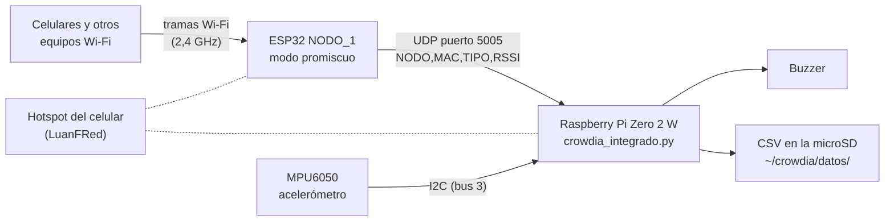
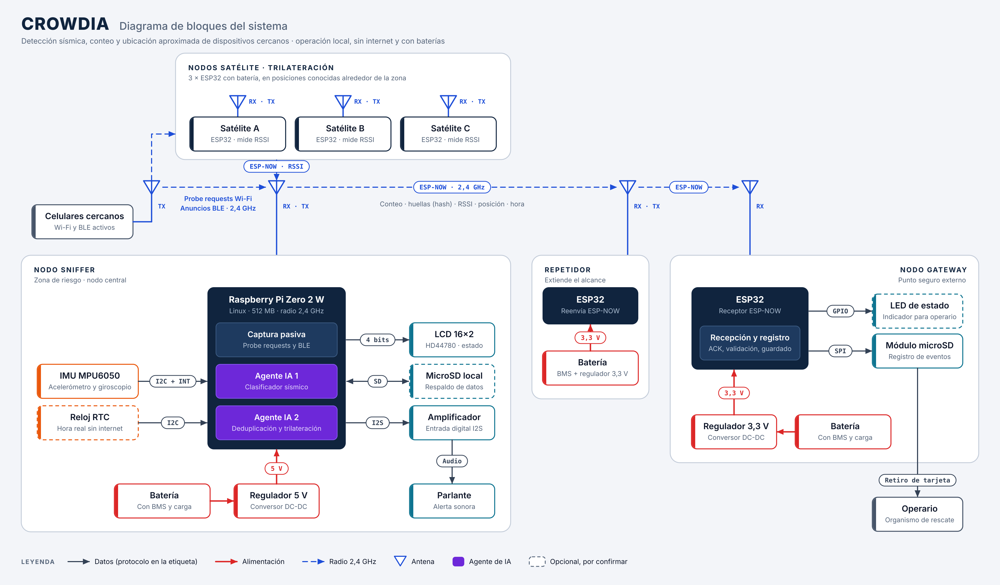

# 1. Visión general del proyecto

## 1.1 ¿Qué es CROWDIA?

CROWDIA es un sistema electrónico para **apoyar la búsqueda de personas atrapadas después de un
terremoto**. La idea es sencilla:

1. Un **nodo sniffer**, instalado en una zona de riesgo (un edificio, una zona concurrida), escucha
   continuamente las señales Wi-Fi que emiten los celulares cercanos y estima **cuántos dispositivos
   hay** y **qué tan cerca están** (por la intensidad de la señal, RSSI).
2. El mismo nodo tiene un **acelerómetro (IMU)** que detecta si está ocurriendo un sismo.
3. Cuando un **agente de IA** confirma que es un sismo real (y no un golpe, pasos o tráfico), el nodo
   **envía lo que había captado** a un **nodo gateway** ubicado en un lugar seguro (por ejemplo, un
   poste), donde los rescatistas pueden recuperar la información.

Todo debe funcionar **sin internet** y **con baterías**, porque después de un sismo fuerte es probable
que no haya energía eléctrica ni red celular.

> **Motivación.** El planteamiento partió de un sismo de magnitud 7,4 en el occidente de Colombia el
> 10 de agosto de 2026, con personas atrapadas durante horas. *Este dato está pendiente de verificar
> con una fuente oficial (Servicio Geológico Colombiano) antes de citarlo en el informe.*

## 1.2 Contexto académico

Proyecto del curso **Diseño de Sistemas Electrónicos** (Universidad Nacional de Colombia, sede Bogotá,
2026-II). Requisitos del curso:

| Requisito | Cómo lo cumple CROWDIA |
|---|---|
| Atender al menos un ODS | Propuesto: **ODS 11** (ciudades resilientes; meta 11.5, reducir las muertes y personas afectadas por desastres). *Por confirmar con el equipo* |
| Usar agentes de IA | **Agente 1:** detección sísmica (sismo / no sismo). **Agente 2:** conteo de dispositivos sin duplicados. Ver [06_proximos_pasos.md](06_proximos_pasos.md) |
| Despliegue local sin internet | Todo el procesamiento ocurre en la Raspberry Pi y los ESP32 |
| Funcionamiento con baterías | Pendiente: diseño de la etapa de potencia (batería, protección, regulador) |
| Entregables | Diagrama de bloques ([img/CROWDIA_diagrama_de_bloques.png](img/CROWDIA_diagrama_de_bloques.png)) y BOM (pendiente) |

El proyecto se evalúa en 5 incisos: (1) idea, ODS, IA, sin internet y baterías; (2) consideraciones
iniciales; (3) manejo de datos; (4) pruebas controladas y análisis con literatura; (5) despliegue.

Presupuesto: máximo **200.000 COP**, sin contar la placa de desarrollo, los ESP32, la impresión 3D ni
el cableado.

## 1.3 Arquitectura actual (lo que funciona hoy)

- El **ESP32** captura las tramas Wi-Fi en modo promiscuo y le envía a la Pi, por cada trama, el
  nodo, la MAC del transmisor, el tipo de trama y el RSSI.
- La **Raspberry Pi** corre `raspberry/crowdia_integrado.py`, que al mismo tiempo:
  - vigila la IMU y decide si hay un sismo (con alerta y buzzer);
  - cuenta los dispositivos cada 60 s, agrupando las MAC aleatorias para no contar varias veces el
    mismo celular;
  - guarda todo en archivos CSV.
- Por ahora el ESP32 y la Pi se comunican a través del **hotspot de un celular**. Es una solución de
  laboratorio; en el diseño final el enlace será **ESP-NOW** (sin router).

## 1.4 Arquitectura planeada (diagrama de bloques)

Incluye lo que falta construir: nodos satélite (para trilateración), repetidor, gateway con ESP32 y
microSD, reloj RTC, etapa de potencia con baterías y la pantalla LCD.

El diagrama original del equipo está en [img/arquitectura_original.png](img/arquitectura_original.png).

## 1.5 Historia de las decisiones

| Fecha | Decisión | Por qué |
|---|---|---|
| Oct 2026 | Dos nodos (sniffer y gateway) enlazados por ESP-NOW | ESP-NOW no necesita router ni internet |
| Oct 2026 | Placa principal: **LicheeRV Nano W** | Tenía NPU para la IA |
| Oct 2026 | La detección de celulares la hace un **ESP32** y no la placa principal | En el ESP32 el modo promiscuo está documentado y hay código abierto (ESP32-Paxcounter); en la LicheeRV el modo monitor no estaba confirmado |
| Oct 2026 | Capturar **antes** del sismo y, al detectarlo, enviar lo ya capturado | Después del sismo los celulares pueden estar apagados o sin batería |
| 8 nov 2026 | La placa principal pasa a ser la **Raspberry Pi Zero 2 W** | Ecosistema maduro (Raspberry Pi OS, Python), 512 MB de RAM |
| 8 nov 2026 | Se evaluó que la Pi capturara con su propio Wi-Fi (modo monitor) | Su firmware Wi-Fi (BCM43430/1, versión 7.45.96.s1) no está en la lista oficial de Nexmon, así que el modo monitor es incierto |
| 21 nov 2026 | El equipo implementa los **sniffers en ESP32** que envían por UDP a la Pi | Es lo que funcionó en la práctica |
| 22 nov 2026 | Programa integrado en la Pi (sismo + dispositivos + buzzer + CSV) | Ver [03_codigos.md](03_codigos.md) |
| 22 nov 2026 | El detector sísmico será un **modelo pequeño propio** (método MyShake), no SeisBench ni PicoClaw | Ver [06_proximos_pasos.md](06_proximos_pasos.md) |

## 1.6 Límites y aspectos éticos ya acordados

- **No hay ubicación GPS** de los celulares: solo conteo y cercanía por RSSI. Con un solo receptor no
  se puede saber en qué habitación está cada uno (lo confirmaron las pruebas). Para ubicar se
  necesitan 3 o más receptores (trilateración).
- **Privacidad (Ley 1581 de 2012):** las MAC se guardan **hasheadas** (SHA-256 con sal) y el uso se
  justifica solo en emergencias.
- **Normas candidatas** (por validar): IEC 61010-1, IEC 61326-1, IPC-6011 Clase 2, IPC J-STD-001,
  IPC-A-600/610. No es dispositivo médico (no aplica INVIMA), según lo que se afirme comercialmente.
