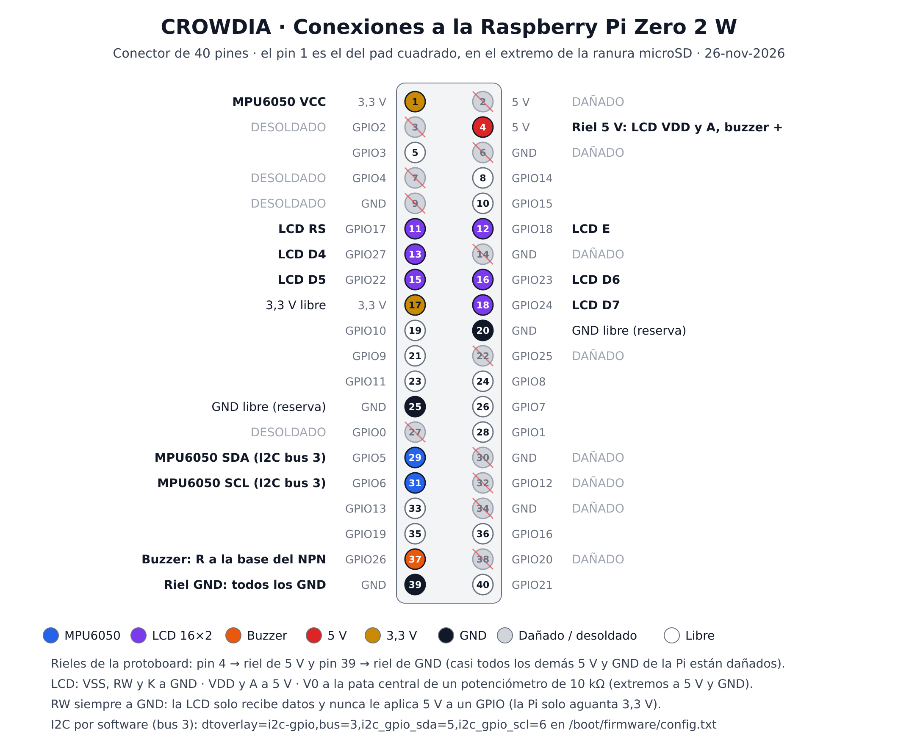

# 2. Hardware y conexiones

## 2.1 Componentes en uso

| Componente | Modelo | Función | Notas |
|---|---|---|---|
| Placa principal | **Raspberry Pi Zero 2 W** (FCC ID 2ABCB-RPIZ2) | Procesa la IMU, cuenta dispositivos, corre los agentes y guarda los datos | BCM2710A1, 4 núcleos Cortex-A53 a 1 GHz, **512 MB** de RAM, Wi-Fi 2,4 GHz b/g/n, Bluetooth 4.2/BLE. Sistema: Raspberry Pi OS 13 (Trixie), 64 bits |
| Sniffer Wi-Fi | **ESP32-WROOM-32U** en placa de desarrollo | Captura las tramas Wi-Fi en modo promiscuo | Antena externa por conector IPEX. Chip ESP32-D0WD-V3 (rev. 3.1); puente USB CP210x. MAC: `78:1C:3C:E3:E8:38` |
| IMU | **MPU6050** (módulo GY-521) | Acelerómetro de 3 ejes para detectar sismos | I2C, dirección 0x68. Ruido medido: 2–5 mg |
| Pantalla | LCD 16×2 **HD44780** | Mostrar el estado del sismómetro y el conteo de celulares | Conexión en paralelo de 4 bits, librería `luma.lcd`. Integrada en `crowdia_integrado.py` (v5) |
| Alarma | Buzzer con transistor NPN y resistencia | Avisar sismos fuertes y celulares detectados | En GPIO26. Funcionando con `crowdia_integrado.py`. Valores de R y transistor sin registrar |
| Alimentación de la Pi | Cargador de pared USB (se usó uno de 33 W) | 5 V en el puerto `PWR IN` | **Con el USB del PC la Pi no arrancaba bien**; con el cargador sí |

## 2.2 Conexiones a la Raspberry Pi (actualizado el 26 de noviembre)



(Versión editable: [`img/conexiones_raspberry.svg`](img/conexiones_raspberry.svg).)

### Pines de la placa que NO se pueden usar

| Estado | Pines físicos | Qué eran |
|---|---|---|
| Desoldados | 3, 7, 9, 27 | GPIO2 (SDA del I2C normal), GPIO4, GND, GPIO0 |
| Dañados | 2, 6, 14, 22, 30, 32, 34, 38 | 5 V, GND, GND, GPIO25, GND, GPIO12, GND, GPIO20 |

Por eso solo quedan **un pin de 5 V (el 4)** y **tres de GND (20, 25 y 39)**. La solución es usar
**rieles en la protoboard**: un cable del pin 4 al riel de 5 V y otro del pin 39 al riel de GND, y
conectar todo lo demás a esos rieles.

### Tabla de conexiones

| Periférico | Señal | Va a | GPIO (BCM) | Pin físico |
|---|---|---|---|---|
| **Alimentación** | Riel de 5 V | 5 V | — | **4** |
| | Riel de GND | GND | — | **39** |
| **MPU6050** | VCC | 3,3 V | — | **1** |
| | GND | Riel de GND | — | (39) |
| | SDA (I2C por software, bus 3) | GPIO5 | 5 | **29** |
| | SCL (I2C por software, bus 3) | GPIO6 | 6 | **31** |
| | AD0 (dirección 0x68) | Riel de GND o sin conectar (el GY-521 lo baja a GND por dentro; estimado) | — | — |
| **LCD 16×2** | 1 VSS | Riel de GND | — | (39) |
| | 2 VDD | Riel de 5 V | — | (4) |
| | 3 V0 (contraste) | Pata central de un potenciómetro de 10 kΩ; los extremos a 5 V y GND | — | — |
| | 4 RS | GPIO17 | 17 | **11** |
| | 5 RW | **Riel de GND** | — | (39) |
| | 6 E | GPIO18 | 18 | **12** |
| | 11 D4 | GPIO27 | 27 | **13** |
| | 12 D5 | GPIO22 | 22 | **15** |
| | 13 D6 | GPIO23 | 23 | **16** |
| | 14 D7 | GPIO24 | 24 | **18** |
| | 15 A (luz de fondo +) | Riel de 5 V | — | (4) |
| | 16 K (luz de fondo −) | Riel de GND | — | (39) |
| | D0–D3 (pines 7–10) | Sin conectar (modo de 4 bits) | — | — |
| **Buzzer** | Resistencia → base del transistor NPN | GPIO26 | 26 | **37** |
| | Emisor del transistor | Riel de GND | — | (39) |
| | Buzzer (+) | Riel de 5 V | — | (4) |
| | Buzzer (−) | Colector del transistor | — | — |

**Por qué RW va a GND:** con RW en GND la LCD solo recibe datos. Si RW quedara en alto, la LCD podría
"responder" con 5 V por sus pines de datos, y los GPIO de la Pi solo aguantan 3,3 V.

**Por qué el buzzer lleva transistor:** un GPIO entrega pocos mA a 3,3 V. El GPIO solo activa el
transistor y la corriente del buzzer sale del riel de 5 V.

```
 Riel 5 V ──── (+) BUZZER (−) ────┐
                                  │ C
 Pin 37 (GPIO26) ── R ──────── B  NPN
                                  │ E
 Riel GND ────────────────────────┘
```

### Configuración del I2C por software
Como el pin 3 (SDA del I2C normal) está desoldado, el sensor va en un **bus I2C por software (bus 3)**.
En `/boot/firmware/config.txt` debe estar esta línea (y ninguna otra con `i2c-gpio`):

```
dtoverlay=i2c-gpio,bus=3,i2c_gpio_sda=5,i2c_gpio_scl=6
```

Después de cambiarla hay que reiniciar (`sudo reboot`).

### Historia de los cambios de pines

| Fecha | Cambio | Motivo |
|---|---|---|
| 9 nov | MPU6050 en GPIO23/24 (pines 16 y 18), bus 3 | Pines 3 y 5 inservibles (pin 3 desoldado) |
| 26 nov | LCD en GPIO17, 18, 27, 22, 23, 24 | Se integró la pantalla al programa |
| 26 nov | MPU6050 pasa a **GPIO5/6 (pines 29 y 31)** | La LCD ocupó GPIO23/24 |
| 26 nov | Buzzer pasa de GPIO17 a **GPIO26 (pin 37)** | La LCD ocupó GPIO17 (RS) |
| 26 nov | 5 V y GND por rieles desde los pines 4 y 39 | Pines 2, 6, 14, 30 y 34 dañados |

## 2.3 Cómo probar cada periférico

Hacer las pruebas en este orden. Si una falla, no seguir hasta resolverla.

| # | Qué se prueba | Comando | Resultado esperado | Si falla |
|---|---|---|---|---|
| 1 | El bus I2C existe | `ls /dev/i2c-3` | Aparece `/dev/i2c-3` | Revisar la línea `dtoverlay` de `config.txt` y reiniciar |
| 2 | La MPU6050 responde | `i2cdetect -y 3` | Un `68` en la tabla | Revisar cables de los pines 29, 31, 1 y GND |
| 3 | La MPU6050 mide | `python3 ~/crowdia/pruebas/mpu_test.py` | `WHO_AM_I: 0x68` y Z ≈ 0,9–1,0 g con el sensor plano; los valores cambian al moverlo | `Remote I/O error`: volver al paso 2 |
| 4 | El buzzer suena | `python3 ~/crowdia/pruebas/prueba_buzzer.py` | 3 pitidos cortos y uno largo | Revisar transistor, resistencia y el pin 37. Si el buzzer es pasivo, poner `BUZZER_ACTIVO = False` |
| 5 | La LCD muestra texto | `python3 ~/crowdia/pruebas/pruebaLCD.py` | `hello, world!` y un contador | Solo cuadros o nada: girar el potenciómetro de V0. Caracteres raros: revisar el orden de D4–D7 |
| 6 | Llegan datos del ESP32 | `python3 ~/crowdia/ver_macs.py` | Aparecen MAC con su RSSI | Revisar la IP (`hostname -I`) y el monitor serie del ESP32 |
| 7 | Todo junto | `python3 ~/crowdia/crowdia_integrado.py` | En la LCD: línea 1 `Reposo N mg`, línea 2 `Cel:N Eq:N S1` al primer minuto | Ver la tabla de problemas de la [guía de uso](05_guia_de_uso.md#56-problemas-frecuentes) |

Para salir de cualquier prueba: `Ctrl + C`.

**Librerías necesarias** (una sola vez):
```
sudo apt install -y i2c-tools python3-smbus python3-gpiozero
pip3 install luma.lcd --break-system-packages
```

## 2.4 Conexiones del ESP32

El ESP32 solo necesita la antena IPEX (conectarla **antes** de energizarlo) y un cable USB de datos.
En el IDE de Arduino se programa como **ESP32 Dev Module** (no como "Arduino Nano ESP32").

## 2.5 Red de laboratorio

| Equipo | Red | Dirección |
|---|---|---|
| Hotspot (celular Redmi) | `LuanFRed`, 2,4 GHz | — |
| Raspberry Pi | Wi-Fi del hotspot | IP variable (vistas: 10.26.70.198 y 10.171.170.198). MAC `2C:CF:67:9B:6D:5C` |
| ESP32 | Wi-Fi del hotspot | IP vista: 10.171.170.211 |

**La IP de la Pi cambia cada vez que se reinicia el hotspot.** Antes de programar el ESP32 hay que
consultarla en la Pi con `hostname -I`.

## 2.6 Acceso a la Raspberry Pi

| Método | Estado |
|---|---|
| **Raspberry Pi Connect** (connect.raspberrypi.com → Remote shell) | ✅ Es el método que se usa. Requiere que la Pi tenga internet |
| SSH por Wi-Fi | Funciona si el PC está en la misma red que la Pi |
| SSH por cable USB (modo "gadget") | ⚠️ Se instaló `rpi-usb-gadget`, pero Windows solo ve el **puerto serie** (COMxx), no la red. Pendiente |
| PicoClaw por Telegram | Asistente con IA (Gemini) instalado en la Pi. Ver [06_proximos_pasos.md](06_proximos_pasos.md) |

## 2.7 Lecciones de hardware

| Problema | Solución |
|---|---|
| La Pi no se conectaba al Wi-Fi y el LED quedaba verde fijo | Era la **alimentación**: con cargador de pared en `PWR IN` arrancó de inmediato |
| El puerto USB de datos de la Pi es el del **centro**; `PWR IN` es solo energía | — |
| `i2cdetect` vacío | Pines desoldados → I2C por software en el bus 3 |
| Pines de 5 V y GND dañados | Rieles de 5 V y GND en la protoboard desde los pines 4 y 39 |
| `cannot import name 'bitbang_6800' from 'luma.core.interface.serial'` | En `luma`, `bitbang_6800` está en `luma.core.interface.parallel` |
| El sensor se movía al sacudir la mesa y daba alertas falsas | **Fijar la MPU6050** a la superficie (cinta doble faz o tornillo) |
| En la Pi Zero el LED verde queda **encendido** en reposo y se apaga con la actividad | Es normal (al revés que en otros modelos) |
