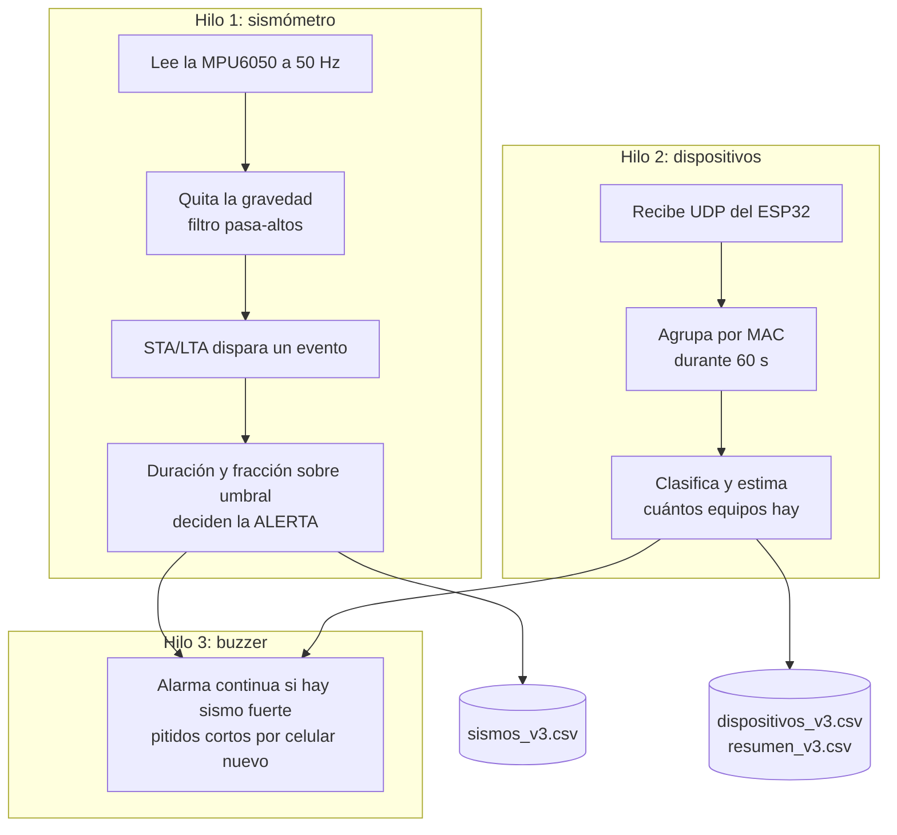

# 3. Los códigos: qué hace cada uno y cómo funciona

Mapa rápido:

| Archivo | Corre en | Estado | Autor |
|---|---|---|---|
| [`esp32/snifferNodo/snifferNodo.ino`](../esp32/snifferNodo/snifferNodo.ino) | ESP32 | ✅ **En uso** con el programa integrado | Equipo, corregido el 22/11 |
| [`esp32/sniffer/sniffer.ino`](../esp32/sniffer/sniffer.ino) | ESP32 | Versión anterior (3 campos) | Equipo |
| [`esp32/snifferCable/snifferCable.ino`](../esp32/snifferCable/snifferCable.ino) | ESP32 | Alternativa por USB, aún no integrada | Equipo |
| [`raspberry/crowdia_integrado.py`](../raspberry/crowdia_integrado.py) | Raspberry Pi | ✅ **Programa principal (v5, con LCD)** | 26/11 |
| [`raspberry/ver_macs.py`](../raspberry/ver_macs.py) | Raspberry Pi | Herramienta de diagnóstico | 22/11 |
| [`raspberry/etiquetar.py`](../raspberry/etiquetar.py) | Raspberry Pi | Etiquetado de eventos para el Agente IA 1 | 22/11 |
| [`raspberry/pruebas/mpu_test.py`](../raspberry/pruebas/mpu_test.py) | Raspberry Pi | Prueba de la IMU | 9/11 |
| [`raspberry/pruebas/pruebaLCD.py`](../raspberry/pruebas/pruebaLCD.py) | Raspberry Pi | Prueba de la LCD | Equipo, corregido el 26/11 |
| [`raspberry/pruebas/prueba_buzzer.py`](../raspberry/pruebas/prueba_buzzer.py) | Raspberry Pi | Prueba del buzzer | 26/11 |
| [`raspberry/historial/`](../raspberry/historial/) | — | Versiones anteriores, para documentar la evolución | — |
| [`simulaciones/`](../simulaciones/) | LTspice | Ver sección 3.5 | Equipo |

---

## 3.1 Sniffers en el ESP32

### Cómo captura un ESP32 los celulares (común a los tres)
1. El ESP32 se pone en **modo promiscuo** (`esp_wifi_set_promiscuous(true)`). En ese modo entrega
   **todas** las tramas Wi-Fi que oye en su canal, no solo las dirigidas a él.
2. Por cada trama se ejecuta una función ("callback") que recibe:
   - el **tipo** de trama: gestión (`MGMT`), datos (`DATA`) o control (`CTRL`);
   - el **RSSI** (intensidad de la señal en dBm; más cerca de 0 es más fuerte);
   - el contenido de la trama (`payload`). En la posición 10 está la **MAC del transmisor**.
3. Los celulares que **buscan redes** envían tramas de gestión llamadas *probe requests* (subtipo
   `0x40`). Los que ya están conectados envían tramas de datos.
4. El callback no envía nada directamente: deja cada trama en una **cola** y el `loop()` la saca y la
   envía. Así el callback es rápido y no se pierden tramas.

### `esp32/snifferNodo/snifferNodo.ino` ✅ (el que se usa)
- Se conecta al hotspot, activa el modo promiscuo y envía cada trama a la Pi por **UDP, puerto 5005**,
  con el formato:
  ```
  NODO_1,AA:BB:CC:DD:EE:FF,MGMT,-58
  ```
  (nodo, MAC del transmisor, tipo, RSSI). Es el formato que espera `crowdia_integrado.py`.
- Pensado para varios nodos: en cada placa se cambia `NOMBRE_NODO` (`NODO_1`, `NODO_2`…).
- **Filtros** (agregados el 22/11), para no contar equipos que no son celulares:

| Se descarta | Cómo se reconoce | Por qué |
|---|---|---|
| Tramas de control | `type == WIFI_PKT_CTRL` | No traen la MAC del transmisor |
| Tramas incompletas | `sig_len < 24` | No alcanzan a tener la cabecera 802.11 |
| Beacons y probe responses | Subtipo `0x80` y `0x50` | Los envían los **routers**, no los celulares |
| Datos que vienen del router | Bandera FromDS (`payload[1] & 0x02`) | El transmisor es el router |
| La propia placa y el sistema | Su MAC y la lista `MACS_SISTEMA` | No contarse a sí mismo ni a la Pi |

- **Credenciales:** la red, la clave y la IP de la Pi van en `secretos.h`, que **no** se sube al
  repositorio (está en `.gitignore`). Se crea copiando `secretos_ejemplo.h`.
- **Limitación:** al estar conectado al hotspot, el ESP32 queda fijo en el **canal del hotspot**. Solo
  ve los equipos de otros canales cuando estos buscan redes en ese canal.

### `esp32/sniffer/sniffer.ino`
Igual a `snifferNodo` pero envía **3 campos** (`MAC,TIPO,RSSI`), sin el nombre del nodo. El programa
integrado espera 4 campos, así que **descarta en silencio** los mensajes de este sketch. Se conserva
como versión anterior.

### `esp32/snifferCable/snifferCable.ino`
- **No se conecta a ninguna red**: queda libre para **saltar de canal** del 1 al 13 cada 250 ms, así
  ve los equipos de todos los canales de 2,4 GHz.
- Envía por el **USB** (puerto serie, 115200 baudios): `MAC,TIPO,RSSI`.
- Clasifica las tramas de gestión: `ROUTER` (beacon, `0x80`), `SONDEO` (probe request, `0x40`) o
  `MGMT` (otras).
- **Ventaja:** cubre todos los canales. **Desventaja:** necesita un cable al equipo que recibe los
  datos. Es una buena opción para conectarlo por USB directamente a la Pi en el nodo sniffer.
- Ejemplo de salida esperada (con MAC ficticias): [`datos/ejemplos/salida_sniffer_ejemplo.txt`](../datos/ejemplos/salida_sniffer_ejemplo.txt).

---

## 3.2 Programa principal: `raspberry/crowdia_integrado.py` (versión 5)

Corre en la Raspberry Pi y hace tres cosas **al mismo tiempo** (en hilos separados):



### 3.2.1 Sismómetro

**Lectura.** Lee los 3 ejes del acelerómetro (registros `0x3B`–`0x40`) en una sola transacción I2C y
los convierte a unidades de g dividiendo entre 16384 (rango de ±2 g). Se activa el filtro digital
interno del sensor a ~21 Hz (registro `0x1A = 4`) para que, muestreando a 50 Hz, no entre ruido de
alta frecuencia (*aliasing*).

**Calibración (10 s).** Con el sensor quieto, promedia cada eje para conocer el vector de gravedad y
mide el **ruido de fondo** (en las pruebas: 1,8–4,9 mg). También reporta la tasa de muestreo real
(≈ 48–50 Hz).

**Vibración = aceleración menos gravedad, como vector.**
- La gravedad se resta **eje por eje** con un filtro **pasa-altos** de constante 0,5 s: la referencia
  de gravedad se actualiza continuamente. Así, si el sensor se inclina o se voltea, en 1–2 s se
  vuelve a ajustar y no queda una "vibración" falsa permanente.
- Antes (versiones 1 a 3) se usaba |a| − g, que casi no ve las sacudidas **horizontales**: 100 mg de
  lado cambian la magnitud total apenas ~5 mg. Las ondas más destructivas de un sismo son mayormente
  horizontales.

**Disparo: STA/LTA.** Es el método clásico de sismología (Allen, 1978; Trnkoczy, NMSOP). Compara la
vibración promedio reciente con la de fondo:
- **STA** (promedio de corto plazo, 0,5 s) y **LTA** (promedio de largo plazo, 60 s), calculados como
  promedios exponenciales: `sta += (a − sta) / (0,5·FS)`.
- Si **STA/LTA ≥ 4**, empieza un evento; si **≤ 2,5**, termina.
- Durante el evento el LTA se **congela** para que la sacudida no se "coma" la relación.
- El LTA arranca en el ruido medido en la calibración, así no hay que esperar 60 s.

**Decisión de alerta (sin IA todavía).** Un golpe dura décimas de segundo; un sismo sacude varios
segundos. Por eso:
- **Duración sobre umbral:** tiempo entre la primera y la última vez que la vibración supera
  **39 mg**. Es la idea de la *duración acotada* ("bracketed duration") de la ingeniería sísmica.
- **Fracción sobre umbral:** qué parte de ese tiempo estuvo por encima de 39 mg.
- **ALERTA** si la duración sobre umbral es **≥ 2 s** y la fracción es **≥ 20 %**.
- La **intensidad** se estima con la tabla aceleración–intensidad de **Wald et al. (1999)**:

| Intensidad | I | II–III | IV | V | VI | VII | VIII | IX+ |
|---|---|---|---|---|---|---|---|---|
| Pico (mg) | < 1,7 | 1,7–14 | 14–39 | 39–92 | 92–180 | 180–340 | 340–650 | > 650 |

- **Buzzer:** alarma continua si hay ALERTA **y** el pico es ≥ 92 mg (intensidad VI, "fuerte").

**En pantalla** se ve una línea que se actualiza:
```
ALERTA SISMO |███████████████          | Vib  50.3 mg | Pico  74.1 mg | R 12.0 | Int V
```
y al terminar cada evento, un resumen:
```
[SISMO] 21:21:50 Evento sostenido: 9.2 s | sobre umbral 7.1 s (41%) | pico 110 mg | int VI | ALERTA
```

### 3.2.2 Conteo de dispositivos

**Recepción.** Escucha en el puerto UDP 5005 y acumula, durante **ventanas de 60 s**, por cada MAC:
número de paquetes, RSSI máximo y tipos de trama.

**El problema de la MAC aleatoria.** Los celulares modernos (iOS 14+, Android 10+) usan una MAC
**aleatoria** cuando buscan redes y la **cambian en cada búsqueda**. Sin corrección, un solo celular
aparecía como 3 a 6 dispositivos (en las pruebas, hasta 21 MAC distintas en un minuto). Una MAC es
aleatoria si el segundo carácter es 2, 6, A o E (bit "administrada localmente").

**Clasificación de cada MAC en la ventana:**

| Estado | Regla | ¿Cuenta? |
|---|---|---|
| `sistema` | Es la Pi o el ESP32 (`MACS_SISTEMA`) | No |
| `debil` | RSSI máximo < −65 dBm (casi siempre, equipos de los vecinos) | No |
| `fija` | MAC de fábrica (no aleatoria) | 1 cada una |
| `estable` | Aleatoria con ≥ 10 paquetes, o vista también en la ventana anterior | 1 cada una |
| `efimera` | Aleatoria de un solo uso | Se **agrupan**: las que llegan con RSSI parecido (±4 dB) cuentan como **un** equipo (`G1`, `G2`…). Si coinciden con una `estable`, no suman (`=estable`) |

**Estimado** = fijas + estables + grupos de efímeras. Además se informa cuánto habría contado **sin
agrupar**, para comparar.

**Buzzer:** al final de cada ventana, un pitido corto por cada **celular nuevo estimado** (máximo 3).

**En pantalla**, al final de cada ventana:
```
[SCAN 6] 16:27:25 | Estimado 2 dispositivos (0 fijos + 2 aleatorios estables + 0 grupos efimeros) | sin agrupar habria contado 9
MAC                paquetes RSSI max  tipo      estado   grupo    nota
2C:CF:67:9B:6D:5C       645      -19  DATA      sistema           Raspberry Pi
...
```

**Limitaciones conocidas:**
- Dos celulares distintos a la misma distancia pueden quedar en un solo grupo (cuenta de menos).
- El RSSI no permite saber en qué habitación está un equipo (ver la prueba controlada en
  [04_pruebas_y_resultados.md](04_pruebas_y_resultados.md)).

### 3.2.3 Datos que guarda (en `~/crowdia/datos/` de la Pi)

| Archivo | Una fila por… | Columnas |
|---|---|---|
| `dispositivos_v3.csv` | MAC en cada ventana | fecha, ventana, `id_hash`, aleatoria, paquetes, rssi_max, tipos, estado, grupo |
| `resumen_v3.csv` | Ventana de 60 s | fecha, ventana, mac_vistas, contados_crudo, fijas, estables, grupos_efimeros, estimado, celulares_est |
| `sismos_v3.csv` | Evento sísmico | fecha, tipo, duracion_s, sobre_umbral_s, fraccion, pico_mg, intensidad, alerta |

**Privacidad:** en los CSV **no se guarda la MAC**, sino un `id_hash` (los primeros 12 caracteres del
SHA-256 de la MAC con una "sal"). Sirve para saber si un equipo se repite entre ventanas sin guardar
su identidad. *La sal está escrita en el código (`SAL = "crowdia-2026"`); en un despliegue real debe
ser secreta.*

### 3.2.4 Grabador de eventos (Agente IA 1, fase A)

Para entrenar el Agente IA 1 se necesita la **señal cruda** de cada evento, no solo su resumen. El
programa guarda siempre los últimos 5 s de la IMU en una memoria circular; cuando STA/LTA dispara un
evento, graba desde **5 s antes** del disparo hasta **2 s después** del final (máximo 60 s).

| Archivo (en `~/crowdia/eventos/`) | Contenido |
|---|---|
| `evt_AAAAMMDD_HHMMSS.csv` | Una fila por muestra (50 por segundo): `t_s` (tiempo relativo al disparo; negativo = antes), `ax_g`, `ay_g`, `az_g` (aceleración cruda en g) y `vib_mg` (vibración sin gravedad) |
| `indice.csv` | Una fila por evento: archivo, fecha, frecuencia de muestreo, lo que decidió la regla actual (tipo, duración, sobre umbral, fracción, pico, alerta) y la **etiqueta** |

La etiqueta se puede dar de dos formas:
- **Al grabar:** `python3 crowdia_integrado.py --etiqueta golpe` deja todos los eventos de esa sesión
  con esa etiqueta. Es lo más rápido para recolectar datos clase por clase.
- **Después:** con [`raspberry/etiquetar.py`](../raspberry/etiquetar.py) (ver sección 3.3).

Etiquetas: `sacudida`, `golpe`, `golpes_repetidos`, `caminar`, `puerta`, `objeto_cae`,
`sensor_movido`, `otro`.

### 3.2.5 Pantalla LCD (desde la v5)

La LCD 16×2 muestra lo mismo que la terminal, resumido, para no depender de un PC:

| Línea | Quién la escribe | Contenido |
|---|---|---|
| 1 | Sismómetro, 10 veces por segundo | `Reposo N mg`, `Evento Ns N mg` o `ALERTA SISMO <intensidad>` |
| 2 | Sniffer, al final de cada ventana de 60 s | `Cel:N Eq:N S<ventana>` o `Sin ESP32 S<ventana>` si no llegó nada |

Cómo funciona:
1. Hay un diccionario `pantalla` con las dos líneas. El sismómetro y el sniffer solo escriben texto
   ahí; ninguno toca la LCD directamente.
2. Un hilo aparte (`lcd_bucle`) revisa ese diccionario cada 0,5 s y escribe en la LCD **solo si algo
   cambió**. Escribir en una LCD por bit-banging es lento; si lo hiciera el sismómetro, perdería
   muestras de los 50 Hz.
3. Cada línea se corta o se rellena a 16 caracteres para que no queden letras viejas.
4. Todo va dentro de `try/except`: si la LCD no está o falla, el programa sigue funcionando sin ella
   y muestra `AVISO: LCD desactivada (...)`.

La librería es `luma.lcd` (clase `hd44780`), con la interfaz `bitbang_6800` de
`luma.core.interface.parallel` en modo de 4 bits.

### 3.2.6 Parámetros que se pueden ajustar

| Parámetro | Valor | Qué controla |
|---|---|---|
| `DURACION_SCAN` | 60 | Segundos por ventana de conteo |
| `UMBRAL_RSSI` | −65 | Señal mínima para contar un equipo |
| `PAQ_MIN` | 10 | Paquetes para confirmar una MAC aleatoria como estable |
| `AGRUPAR_DB` | 4 | Tolerancia en dB para agrupar MAC efímeras |
| `MACS_SISTEMA` | Pi y ESP32 | Equipos propios que no se cuentan |
| `ON` / `OFF` | 4,0 / 2,5 | Disparo y fin de evento (STA/LTA) |
| `ALERTA_MG` | 39 | Umbral para la duración sobre umbral (intensidad V) |
| `T_MIN` | 2,0 | Duración mínima sobre umbral para alertar |
| `FRAC_MIN` | 0,2 | Fracción mínima sobre umbral para alertar |
| `HP_S` | 0,5 | Constante del filtro pasa-altos de la gravedad |
| `BUZZER_PIN` / `BUZZER_ACTIVO` | 17 / True | Pin y tipo de buzzer |
| `BUZZER_MG` | 92 | Pico mínimo para la alarma sonora (intensidad VI) |

---

## 3.3 Herramientas y pruebas en la Raspberry Pi

### `raspberry/ver_macs.py`
Diagnóstico: escucha 60 s el puerto 5005 y muestra una tabla con cada MAC, paquetes, RSSI máximo,
tipo y notas (Raspberry Pi, MAC aleatoria, débil). Sirvió para identificar qué dispositivo era cada
MAC. **No se puede correr al mismo tiempo que el integrado** (ambos usan el puerto 5005).

### `raspberry/etiquetar.py`
Recorre `~/crowdia/eventos/indice.csv` y muestra cada evento con lo que midió la regla (duración,
fracción sobre umbral, pico). Se le asigna la etiqueta escribiendo un número.
- `python3 etiquetar.py`: solo los eventos sin etiqueta.
- `python3 etiquetar.py --todas`: todos, para corregir.
- `python3 etiquetar.py --resumen`: cuántos eventos hay por etiqueta.

### `raspberry/pruebas/mpu_test.py`
Primera prueba de la IMU: imprime los 3 ejes del acelerómetro (g), del giroscopio (°/s) y la
temperatura, 5 veces por segundo. Con el sensor quieto dio Z ≈ 0,92–0,93 g (desfase de fábrica,
dentro de especificación) y el giroscopio con un desfase de 1–2 °/s.

### `raspberry/pruebas/pruebaLCD.py`
Muestra "hello, world!" y un contador en la LCD 16×2 usando la librería `luma.lcd`, en modo paralelo
de 4 bits (RS = GPIO17, E = GPIO18, D4–D7 = GPIO27, 22, 23, 24). El 26/11 se corrigió la importación:
`bitbang_6800` está en `luma.core.interface.parallel`, no en `.serial`.

### `raspberry/pruebas/prueba_buzzer.py`
Hace sonar el buzzer (GPIO26) con 3 pitidos cortos y uno largo. Sirve para comprobar el transistor y
el cableado sin correr el programa completo.

---

## 3.4 Historial: cómo evolucionó el detector

Todas las versiones están en [`raspberry/historial/`](../raspberry/historial/).

| Versión | Archivo | Qué cambió | Por qué se cambió después |
|---|---|---|---|
| Prueba IMU | `pruebas/mpu_test.py` | Lectura cruda de los ejes | Solo era una prueba |
| Sismo v1 | `historial/crowdia_sismo.py` | STA/LTA (0,5 s / 10 s), barra visual, estados Reposo / Vibración / POSIBLE SISMO | El LTA no se congelaba: una sacudida fuerte se quedaba en "Vibración"; umbrales sin respaldo |
| Sismo v2 | `historial/crowdia_sismo2.py` | LTA de 60 s **congelado** durante el evento, disparo 4 y fin 2,5 (recomendaciones de Trnkoczy), intensidad de Wald, resumen por evento | Golpes de ~1 s daban ALERTA; la calibración era muy corta |
| Sismo v3 | `historial/crowdia_sismo3.py` | Calibración de 10 s con cuenta regresiva, barra logarítmica, **duración mínima de 2 s** para alertar | 4 de 6 golpes dieron falsa alerta (el sensor se movía y |a| − g no veía lo horizontal) |
| Sismo v4 | `historial/crowdia_sismo4.py` | Gravedad restada **por eje**, **duración y fracción sobre umbral** | Si el sensor se inclinaba durante un evento, la alerta quedaba pegada |
| Integrado de PicoClaw | `historial/integrado_picoclaw.py` | Primer programa que unió sismo y sniffer (lo generó el agente PicoClaw) | Se quedaba en "EVENTO" desde el inicio (STA y LTA arrancaban en 0); no guardaba CSV |
| Integrado v1 | `historial/crowdia_integrado_v1.py` | Sismo v4 + sniffer + tabla por ventana + CSV con MAC hasheadas | Alerta pegada al inclinarse el sensor |
| Integrado v2 | `historial/crowdia_integrado_v2.py` | **Filtro pasa-altos** por eje (soluciona la alerta pegada) + **buzzer** + columna "probable celular" | Contaba hasta 9 equipos con ~4 reales (MAC aleatorias) |
| Integrado v3 | `historial/crowdia_integrado_v3.py` | **Persistencia y agrupación** de MAC aleatorias, CSV de resumen por ventana | Faltaba guardar la señal cruda para entrenar la IA |
| Integrado v4 | `historial/crowdia_integrado_v4.py` | **Grabador de eventos** (señal cruda) y opción `--etiqueta` | Se agregó la LCD |
| **Integrado v5** | `crowdia_integrado.py` | **Pantalla LCD** y pines nuevos (MPU6050 en GPIO5/6, buzzer en GPIO26) | Versión actual |

---

## 3.5 Simulaciones (`simulaciones/`)

| Archivo | Qué es |
|---|---|
| `ICL7660.asc` | Inversor de voltaje por bomba de carga (modelado con LTC1044), alimentado con 9 V y condensadores de 10 µF. Genera un voltaje negativo |
| `Electrometro.asc` | Amplificador de instrumentación AD620 con fuente de ±9 V y resistencia de entrada de 1 MΩ |

*Parecen venir del proyecto anterior del equipo (la "lengua electrónica"), que se descartó; no forman
parte de CROWDIA. Confirmar con el equipo si se dejan en el repositorio.*

---

## 3.6 Archivos que existen solo en la Raspberry Pi

En `~/.picoclaw/workspace/` de la Pi hay archivos que el equipo creó con PicoClaw y que **no están en
el repositorio**: `analizador.py`, `sniffer_v2.py`, `crowdia_sismo3.py`, `monitor_daemon.py.bak` e
`integrado.py` (este último transcrito en `historial/`). Conviene revisarlos y subir los que sirvan.
